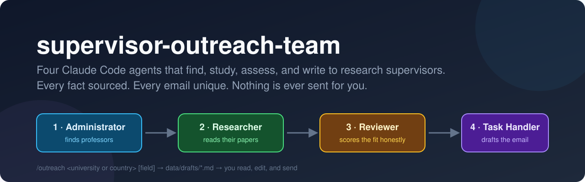
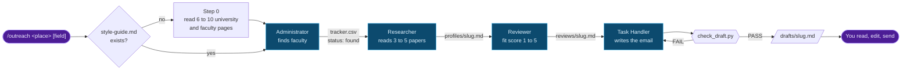
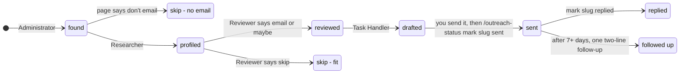

<p align="center">
  
</p>

<p align="center">
  
  
  
  
  
</p>

A [Claude Code](https://claude.com/claude-code) plugin for anyone applying to a research master's or PhD. Give it a university or a country. It finds professors whose recent work matches yours, reads their papers, judges the fit honestly, and writes one plain, personal email per professor for you to read, edit and send yourself.

```text
/outreach University of Waterloo
```

## Why it exists

Cold emailing supervisors goes badly in two common ways. One is the mass email that names no paper. The other is the over-polished AI email that professors now spot at a glance. Graduate schools and faculty pages say the same things again and again: read their work, be specific, keep it short, write to one person ([sources](data/style-guide.md#sources)). This plugin does the reading and checking, and leaves the final judgement to you.

| What it does | How it does it |
|---|---|
| **Never sends email** | Only writes drafts to `data/drafts/`. None of the agents has a mail tool. |
| **Sources every fact** | Each claim about a professor in a profile links to the page or paper it came from. |
| **Says no when the fit is weak** | The reviewer is told not to stretch your experience. Weak fits are marked `skip`. |
| **Writes no two emails alike** | No template. A checker script rejects reused sentences, same-shaped openings and closings, and any opening style, part order or closing style used in the last 10 drafts. |
| **Sounds like a person** | Banned stock phrases, no em dashes, no lists, no flattery, 110 to 170 words. |
| **Respects professors' rules** | "Don't email me" means `skip`. "Apply first" and required subject lines are recorded and followed. |

## How it works



The agents pass work to each other through files in `data/`, not through chat, so each step can be read, corrected and re-run on its own. Every stage works on all rows in its input status, so a run that stopped half-way finishes on the next `/outreach`.

### Life of a tracker row



## Quick start

You need [Claude Code](https://claude.com/claude-code) and Python 3.

```bash
git clone https://github.com/NiloyBhattacharjee/supervisor-outreach-team.git
cd supervisor-outreach-team
cp data/me.example.md data/me.md     # then fill it in honestly
claude --plugin-dir .
```

Then, inside Claude Code:

```text
/supervisor-outreach-team:outreach University of Waterloo software engineering
```

`data/me.md` is the only source of facts about you. The agents never add to it, so anything not in it never appears in an email. Mark unbuilt projects as `(planned)`, and they won't be written up as if they exist.

## Commands

| Command | What it does |
|---|---|
| `/outreach <university or country> [field]` | Runs the full pipeline. Options: `max N` (new professors per run, default 8), `include maybe`, `tracker <path>` (skip people in an existing spreadsheet), `refresh style` (rebuild the style guide). |
| `/outreach-status` | Counts and table by status, plus who is due a follow-up (sent more than 7 days ago, no reply). |
| `/outreach-status mark <slug> sent [date]` | Records that you sent it. `replied` works the same way. |

Plugin commands are namespaced. If the short name doesn't autocomplete, use the full form, for example `/supervisor-outreach-team:outreach`.

## What you get per professor

```text
data/
├── tracker.csv              one row per professor: status, fit, links, notes
├── profiles/smith-uni.md      field, 3 to 5 papers with what each actually did, limits on fit
├── reviews/smith-uni.md       fit score, best paper, real links to your work, gaps, verdict
└── drafts/smith-uni.md        to, subject, body, sign-off, and "Check before sending" notes
```

Every draft is checked before it is saved. The task handler rewrites it until the checker passes, up to four times:

```text
$ python scripts/check_draft.py data/drafts/example-uni.md
words=141 paragraphs=3 closest=0.24 vs other-uni.md
FAIL: opening has the same shape as other-uni.md: 'Your study of flaky CI builds found ...'
FAIL: banned wording: resonat
FAIL
```

The checker uses only the Python standard library. Run `python scripts/check_draft.py --selftest` to check it.

## Project layout

```text
.claude-plugin/plugin.json     plugin manifest
commands/outreach.md           orchestrator: style guide, then the four agents in order
commands/outreach-status.md    tracker view, follow-ups, mark sent or replied
agents/administrator.md        finds faculty, never guesses an email address
agents/researcher.md           reads papers through DBLP, Semantic Scholar and arXiv APIs
agents/reviewer.md             honest fit score, gaps, research idea, verdict
agents/task-handler.md         writes and checks the email
scripts/check_draft.py         word count, banned words, similarity to earlier drafts
data/style-guide.md            emailing advice from 10 university and faculty pages, with links
data/me.example.md             template for your profile
```

## Privacy

Your profile, tracker, profiles, reviews and drafts are in `.gitignore` and stay on your machine. Only the template and the sourced style guide are committed.

## Limits

- Some sites block automated fetches (DBLP's bot check, for example). The agents record what failed and keep going, so read the tracker's notes.
- The similarity checker catches reused wording, not reused ideas. The task handler is also told to reread for sameness, and you are the final check.
- Universities change their rules. Admissions and funding facts are copied from pages on the day of the run, so confirm them before you apply.
- Professors increasingly spot AI-written email. Treat every draft as a first draft and put it in your own words before sending.

## License

[MIT](LICENSE)
